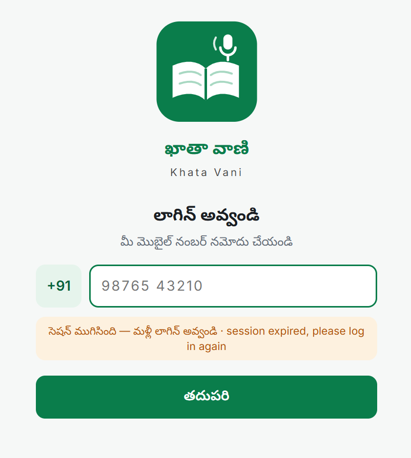
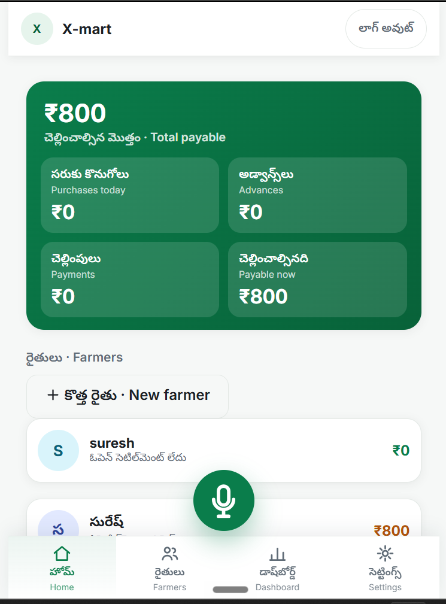
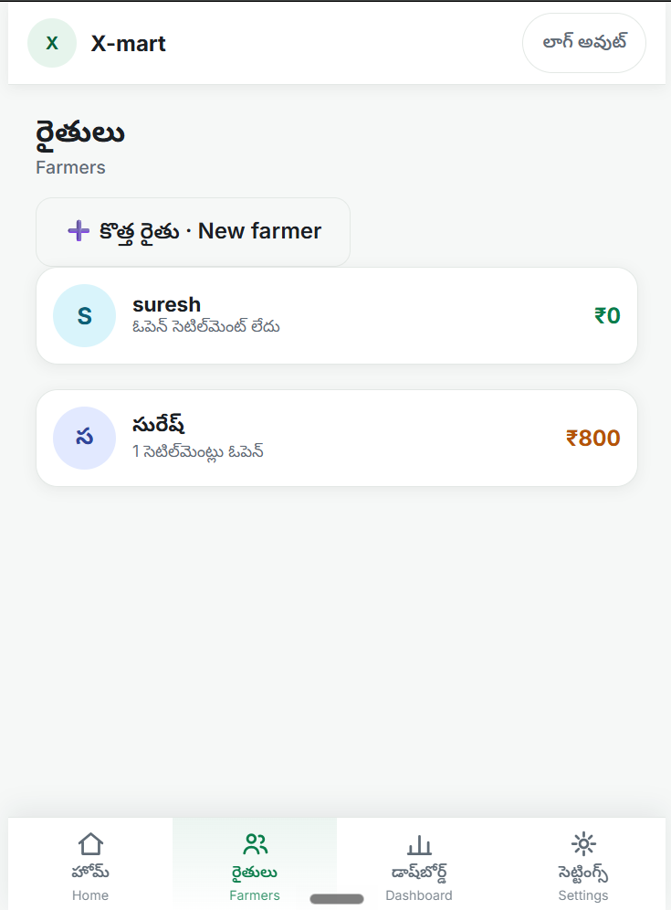
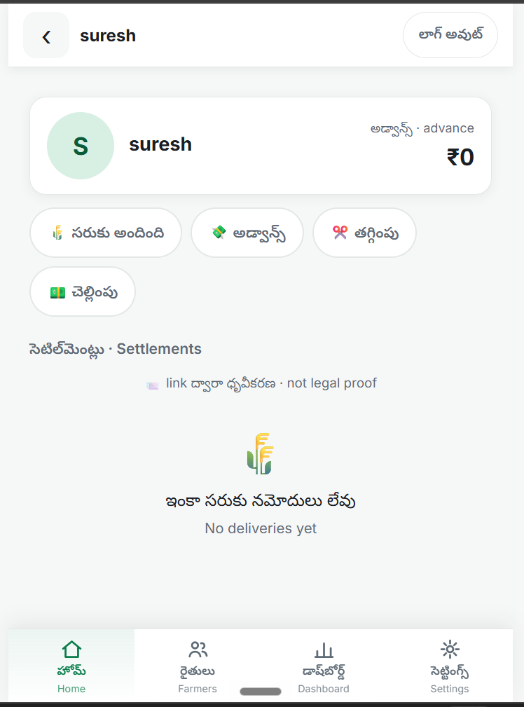
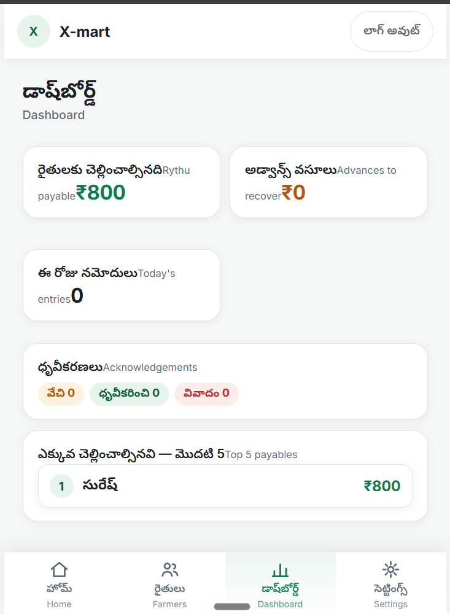
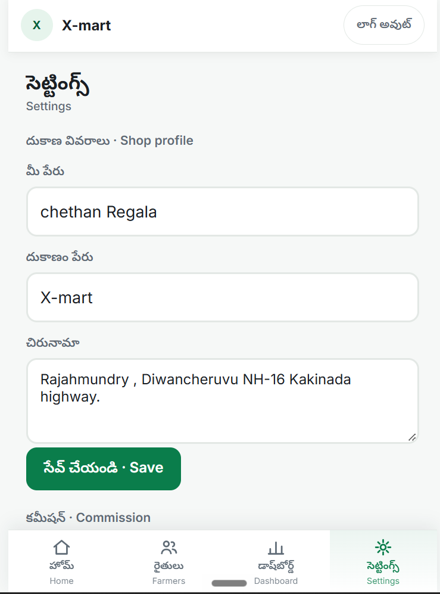
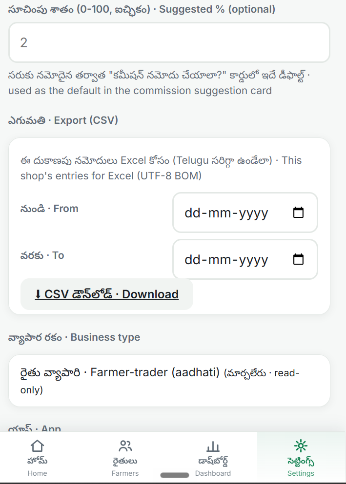
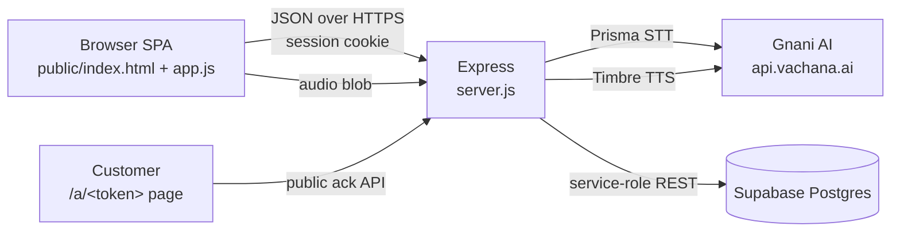

<!--
  ============================================================================
  TODO — FINAL ITEMS
  ============================================================================
  1. AUTHOR_LINKEDIN_URL — author's LinkedIn profile URL (Author section)
  2. AUTHOR_X_URL        — author's X profile URL (Author section)
  3. <repo-url>          — public repository URL (Getting started)

  Logos and screenshots are the real assets supplied by the author and live in
  docs/assets/. See docs/assets/README.md for what each image shows.
  ============================================================================
-->

<p align="center">
  
</p>

<h1 align="center">Khata Vani (ఖాతా వాణి)</h1>

<p align="center"><em>Speak your ledger</em></p>

<p align="center">
  <a href="https://khata-vani.onrender.com"></a>
  <a href="https://drive.google.com/drive/folders/16wPHTQYKHq6VWhGlVpNPKi2bBvQd0Y6s?usp=drive_link"></a>
  = 20">
  
  
</p>

Khata Vani is a voice-first ledger for small Indian businesses: the shopkeeper speaks a
transaction in Telugu, the app shows a confirmation card, and only then writes the entry
to a server-side ledger. It serves two focused workflows chosen at sign-up — **Kirana**
(shop credit and repayments) and **Rythu** (farmer produce settlements) — and lets a
customer acknowledge a credit through a secret link, with QR and Telugu audio, without
installing an app or logging in.

## Built for

<p align="center">
  
  &nbsp;&nbsp;&nbsp;
  
</p>

<p align="center"><strong>Solo entry by Chethan Regala, B.Tech, Godavari Global University</strong></p>

## Quick links

| Resource | Link |
|---|---|
| Live app | [khata-vani.onrender.com](https://khata-vani.onrender.com) |
| Demo video | [Google Drive demo folder](https://drive.google.com/drive/folders/16wPHTQYKHq6VWhGlVpNPKi2bBvQd0Y6s?usp=drive_link) |
| One-page pitch | [PITCH.md](./PITCH.md) |
| LinkedIn post | [LinkedIn post](https://lnkd.in/p/dPt4PyEp) |

## The problem

Small kirana shops and produce traders still run on a paper *khata*. Writing every
credit and repayment is slow, balances are easy to get wrong, and a customer has no
easy way to check or acknowledge what is owed. Typing on a phone in Telugu is awkward
for many shopkeepers, so software that assumes a keyboard often goes unused.

## The solution

Khata Vani makes **speaking** the primary input. A shopkeeper says the entry, hears or
reads the confirmation, and taps once to save. The ledger lives in Postgres, not on the
device, so it survives a lost phone. At sign-up the user picks exactly one of two
focused products:

- **Kirana** — customer credit, repayments, statements and acknowledgement links.
- **Rythu** — farmer deliveries, advances, deductions, payments and settlement slips.

## Screenshots

| | |
|---|---|
| <br>**01 — Login.** Phone number entry; the spoken-word check and PIN follow. | <br>**02 — Rythu home.** Total payable, advances, payments and the farmer list. |
| <br>**03 — Farmers.** Farmer accounts with their open settlement count. | <br>**04 — Farmer account.** Advances, entry actions and the settlement list. |
| <br>**05 — Dashboard.** Payable, advances to recover, today's entries, acknowledgements, top 5. | <br>**06 — Settings.** Shop profile and commission defaults. |
| <br>**07 — Settings / export.** Default commission, CSV export with date range, business type. | |

## Features by workflow

### Kirana

- Voice credit entries and repayments, parsed from Telugu (with English fallback) and
  confirmed on a card before saving.
- Customer creation with optional opening balance, edit, and merge of duplicate names.
- Integer-paise money math with Indian digit grouping; no floating-point rupees.
- Reversals instead of deletes: a mistake is undone by one offsetting row.
- Per-customer statement with opening balance, running balance and optional date range.
- CSV export for a date range, with UTF-8 BOM and formula-injection guarding.
- Discounts, payment modes (cash / UPI / bank / other) and commission categories.
- Every saved entry carries a client idempotency key, so a retry cannot double-post.

### Rythu

- A produce delivery (quantity × rate, computed on the server) becomes a settlement
  anchor for that farmer.
- Advances, deductions (hamali, commission, transport and similar categories) and
  payments auto-link to the open settlement.
- Excess payment is refused unless the user explicitly allows it, in which case the
  excess is parked as an unallocated advance.
- Settlement read-model with an exact cash-out remaining balance.
- Itemised, printable settlement slip and farmer statement.

### Trust and acknowledgement

- Any kirana credit can mint a secret `/a/<token>` link with a QR code and Telugu audio.
- Tokens are stored hashed, expire, and are revocable; one active link per entry.
- The customer can acknowledge, dispute or resolve — no app and no login.
- Re-minting a link revokes the awaiting one; answered links keep their truthful state.
- The UI states plainly that a link acknowledgement is a record, not legal proof.

## How Gnani AI is used

| Feature | Model | Where in the code |
|---|---|---|
| Spoken ledger entry, balance query, name-choice reply | **Prisma STT** (`prisma-v3.0`, `indic-auto` default) | `POST /api/stt` in `server.js` |
| Custom vocabulary for shop and customer names | **Prisma STT** `keyterms` field | `server.js` STT proxy (keyterms builder) |
| Login word challenge audio | **Timbre TTS** (`timbre-v2.5`, voice `Nalini`, `te-IN`) | `wordAudio()` → `/api/auth/challenge/audio/:challengeId` |
| Confirmation and answer playback | **Timbre TTS** | `gnaniTts()` → `POST /api/tts` |
| Acknowledgement-link audio | **Timbre TTS** | `/a/:token/audio` with a token-hash-keyed cache |

All Gnani calls are server-side proxies. The browser never sees the API key, raw
provider payloads are not forwarded, and per-shop rate limits protect the credits.

## Architecture



**Voice-entry sequence.** The browser records a clip and posts it to `/api/stt`. The
server proxies it to Prisma, returns only the transcript and parsed proposal, and the
SPA shows a confirmation card. Confirming posts the entry with an idempotency key; the
server recomputes the amount, writes the ledger row in Supabase, and responds with the
saved entry. TTS is a convenience at every step — if audio fails, the text card still
works.

## Engineering highlights

- **Idempotent saves** — `shop_id + idempotency_key` is unique; retries and double-taps
  cannot create a second transaction.
- **Reversal instead of delete** — history is append-only; an offsetting row preserves
  the audit trail.
- **Integer-paise money math** — all arithmetic is in paise, with explicit conversion at
  the API boundary and Indian grouping in the UI.
- **Per-shop isolation** — every query filters `shop_id` from the signed session; client
  IDs are re-checked against that shop, including public acknowledgement reads.
- **Security headers and CSP** — strict Content-Security-Policy, `X-Frame-Options: DENY`,
  `Permissions-Policy`, HSTS in production, same-origin CSRF guard, opaque error handler.
- **Rate limits** — separate buckets for auth (30 per 15 min), challenge audio (60/min)
  and per-shop STT/TTS, so one shop or a stranger cannot burn Gnani credits.
- **Log scrubbing** — secrets, tokens, phone numbers and transcripts are not logged;
  startup validation refuses weak or placeholder secrets in production.
- **Automated tests** — **432 hermetic checks across 9 suites** (parser 31, resolver 13,
  security 109, ledger 50, rythu 86, acknowledgements 52, business type 39, accounting 42,
  audio 10) plus **78 end-to-end smoke checks** against the real server and database.

## Getting started

### Prerequisites

- Node.js **20 or newer** and npm.
- A Supabase project (Postgres + service-role key, server-side only).
- A Gnani AI API key for Prisma STT and Timbre TTS.

### Install

```bash
git clone <repo-url> khata-vani
cd khata-vani
npm install
cp .env.example .env
```

Fill `.env` from the table below. Never commit it.

### Environment variables

| Name | Purpose |
|---|---|
| `GNANI_API_KEY` | Gnani AI key for STT and TTS (server-side only) |
| `STT_LANG` | Default STT language (`indic-auto` in `.env.example`) |
| `TTS_VOICE` | Timbre voice name (default `Nalini`) |
| `TTS_LANG` | TTS language (default `te-IN`) |
| `TTS_MODEL` | TTS model (default `timbre-v2.5`) |
| `PORT` | HTTP port (default `3000`) |
| `SUPABASE_URL` | Supabase project URL |
| `SUPABASE_SERVICE_KEY` | Supabase service-role key; `SUPABASE_SECRET_KEY` is also accepted |
| `JWT_SECRET` | Long random string used to sign session and challenge tokens |
| `NODE_ENV` | `production` enables secure cookies, HSTS and strict config checks |
| `APP_ORIGIN` | Canonical public origin used when building acknowledgement links |
| `TRUST_PROXY` | Set to `1` behind Render or another trusted proxy, for real client IPs |
| `KEEPALIVE_TOKEN` | Secret for the `/keepalive` cron endpoint |
| `TTS_CACHE_DIR` | Optional override for the TTS cache directory |

### Database migrations

Apply the SQL files in `supabase/migrations/` **in filename order** (SQL editor or
Supabase CLI):

```text
002_ledger_foundation.sql
003_acknowledgements.sql
003_fix_post_transactions_cte.sql
004_business_type.sql
005_accounting_essentials.sql
006_fix_post_transactions_payment_mode.sql
```

The migrations are additive; existing ledger rows are not rewritten.

### Run

```bash
npm start
# http://localhost:3000
```

### Test

```bash
npm test        # 432 hermetic checks, no network or credits used
npm run smoke   # 78 end-to-end checks; the server must be running
npm run lint    # ESLint (0 errors on the cleaned tree)
```

`npm run smoke` signs up a throwaway shop against the real Supabase project, exercises
the Rythu save path, and deletes every row it created.

### Seed and clean demo data

```bash
npm run seed        # create the two demo shops and their fake ledger
npm run seed:clean  # delete the demo shops and all their rows
```

<a id="demo-logins"></a>
**Demo logins** — all data is fake:

| Product | Phone | PIN | Shop |
|---|---|---|---|
| Kirana | `9000000001` | `1234` | Demo Kirana |
| Rythu | `9000000002` | `1234` | Demo Rythu |

Login is phone → listen to the challenge and pick the spoken word → PIN. The spoken
word is part of the demo login, not phone-ownership verification (see limitations).

## Deployment on Render

- **Build command:** `npm install`
- **Start command:** `npm start`
- **Environment:** `NODE_ENV=production`, `TRUST_PROXY=1`,
  `APP_ORIGIN=https://<your-domain>`, plus the variables in the table above
  (`GNANI_API_KEY`, `SUPABASE_URL`, `SUPABASE_SERVICE_KEY`, `JWT_SECRET`,
  `KEEPALIVE_TOKEN`).
- **Health check:** `GET /healthz` returns `{"ok":true}` and stays public and secret-free.
- **Keep-alive:** create an external cron (for example cron-job.org) that calls
  `GET https://<your-domain>/keepalive?k=<KEEPALIVE_TOKEN>` every 5 minutes. The correct
  token answers `{"ok":true}`; anything else reads as a generic 404 and the token is
  never echoed or logged.
- **Free tier:** Render's free instance sleeps after idle. The first request can take
  tens of seconds; the browser shows a non-blocking wake-up banner and retries failing
  GETs once. The TTS cache lives in `data/tts-cache/` and regenerates if absent.

## Project structure

```text
khata-vani/
├── server.js                  Express app: auth, ledger API, STT/TTS proxies, ack pages
├── security.js                Headers, CSP, CSRF guard, log scrubbing, secret checks
├── lib/
│   ├── ledger.js              Transaction posting, idempotency, reversals, settlements
│   ├── accounting.js          Opening balances, discounts, payment modes, commission
│   ├── money.js               Integer-paise math and Indian formatting
│   ├── ack.js                 Hashed acknowledgement tokens and state machine
│   └── business-type.js       Kirana / Rythu access rules
├── public/
│   ├── index.html             App shell (SPA)
│   ├── app.js                 Hash-routed UI, mic flow, statements, dashboard
│   ├── parser.js              Rule-based Telugu/English ledger parser
│   ├── rythu-parser.js        Rule-based produce/settlement parser
│   ├── resolver.js            Exact/label/alias/fuzzy name matching
│   ├── api.js                 Fetch wrapper with session handling
│   ├── ack.html / ack.js      Public acknowledgement page
│   ├── styles.css / ack.css   Design system and ack page styles
│   └── icon.svg, icon-192/512.png, manifest.webmanifest, favicon.ico
├── supabase/migrations/       Numbered, additive SQL migrations
├── scripts/
│   ├── seed-demo.js           Demo shops and fake ledger (seed / seed:clean)
│   ├── smoke-rythu.js         End-to-end Rythu smoke test with cleanup
│   └── make-icons.js          One-shot PWA icon generator (needs `sharp` via npx)
├── tests/                     Hermetic suites for rythu, ack, accounting, audio, type
├── test-*.js                  Hermetic suites for parser, resolver, security, ledger
├── docs/
│   ├── SECURITY.md            Security hardening report
│   └── assets/                README images (placeholders until replaced)
├── PITCH.md                   One-page pitch
├── .env.example               Environment variable names and safe defaults
├── .gitignore
├── eslint.config.js
├── package.json
└── package-lock.json
```

## Known limitations

- **Demo-grade login:** phone + spoken-word check + PIN proves device/audio interaction,
  not phone ownership. Production roadmap: SMS OTP and passkeys.
- **Acknowledgement is not legal proof:** anyone holding the secret link can answer.
  Links are hashed, expiring and revocable, but possession is the only credential.
- **Rule-based parser:** there is no LLM fallback; unusual phrasings fall back to manual
  entry with a friendly explanation.
- **Free-tier cold starts:** the first request after idle can take tens of seconds, and
  STT/TTS add their own latency.

## Roadmap

- Dairy workflow (milk entries, rate charts, route-level settlements).
- Offline-first entry capture with a sync queue.
- More Indian languages beyond Telugu and English.
- Production identity: SMS OTP and passkeys.

## Acknowledgements

Built for the **Great Indian AI Internship Challenge** with **Gnani AI** — Prisma for
speech-to-text and Timbre for text-to-speech. Gnani AI and challenge logos belong to
their respective owners and are used here only for attribution.

**Author:** Chethan Regala, B.Tech, Godavari Global University ·
[LinkedIn](AUTHOR_LINKEDIN_URL) · [X](AUTHOR_X_URL)

License: to be added
